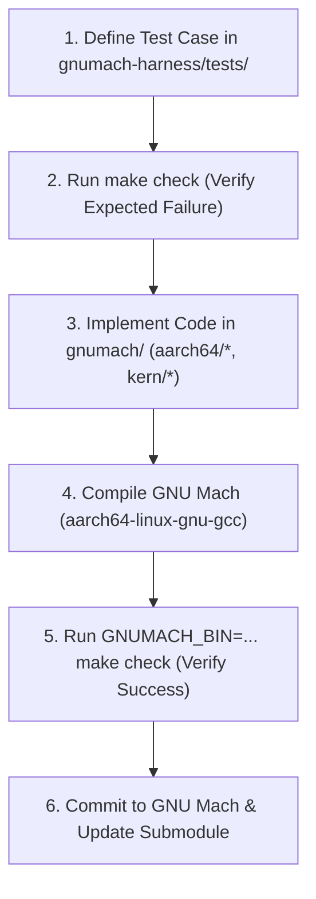

# Kernel Development Guide with gnumach-harness

This document describes how to use **gnumach-harness** to drive development and debugging of the **GNU Mach** microkernel (specifically the `aarch64` port).

---

## 1. Overview and Core Philosophy

Developing an early-stage microkernel on a new architecture presents a bootstrapping challenge: before the serial console driver, page tables, or user-space task schedulers are functional, the kernel cannot report its own status or errors.

**gnumach-harness** solves this by acting as an **external verification oracle** via the QEMU **QTest** protocol. Because the test harness executes outside the guest virtual machine, it can:
* Inspect physical memory and memory-mapped input/output (MMIO) registers directly.
* Advance virtual time deterministically without relying on host system latency.
* Validate kernel milestone transitions (such as `.bss` zeroing, page table population, and early device setup) before user space is available.

---

## 2. Test-Driven Development (TDD) Workflow

The development loop connects **gnumach-harness** directly to the GNU Mach source tree:



1. **Write the Harness Test First**: Define the expected physical state or register value indicating success.
2. **Execute and Observe Failure**: Ensure the test fails for the intended reason before implementing the kernel feature.
3. **Modify GNU Mach**: Implement the smallest set of instructions in assembly or C to satisfy the milestone.
4. **Compile the Kernel**: Build the `gnumach` binary using the cross-toolchain.
5. **Re-run the Harness**: Confirm that the test transitions from failure to success (`[PASS]`).
6. **Commit Changes**: Push the kernel commits to the `aarch64` branch, then update the submodule commit in `gnumach-harness`.

---

## 3. QTest Inspection Strategies

When formulating tests to guide kernel modifications, three primary inspection patterns are available:

### Strategy A: Global Symbol State Inspection

You can resolve the physical address of any global symbol in `gnumach.elf` using `nm` or `readelf`:

```bash
aarch64-linux-gnu-nm gnumach.elf | grep "hyp_available"
```

In the harness test case, read the memory address:

```c
/* Read the kernel variable directly from physical RAM */
uint32_t hyp_flag = qtest_readl(s, ADDR_HYP_AVAILABLE);
QTEST_ASSERT_EQ(hyp_flag, 1);
```

* **Diagnostic Value**: If the assertion fails, the execution sequence halted before completing the hypervisor detection logic in `aarch64/boot.S`.

---

### Strategy B: MMIO Peripheral Register Probing

On the QEMU `virt` machine for AArch64, emulated devices reside at fixed physical memory addresses:
* **PL011 UART Base**: `0x09000000`
  * Data Register (`UARTDR`): `0x09000000`
  * Control Register (`UARTCR`): `0x09000030`
* **GIC Distributor Base (version 2)**: `0x08000000`

When implementing device drivers (such as console output in `model_dep.c`), assert that peripheral control registers are correctly initialized:

```c
/* Verify that the PL011 UART has been enabled by the kernel driver */
uint32_t cr = qtest_readl(s, 0x09000030);
QTEST_ASSERT(cr & 0x1); /* UARTEN bit enabled */
```

* **Diagnostic Value**: If `cr` remains zero, the console initialization function was either skipped, halted prematurely, or wrote to an incorrect address.

---

### Strategy C: Memory Zeroing and Page Table Validation

Early boot routines must zero the `.bss` section and establish initial page tables (e.g., translation table base registers `TTBR0_EL1` and `TTBR1_EL1`).

You can verify memory bounds with block reads:

```c
uint8_t buffer[64];
bool ok = qtest_memread(s, BSS_PHYSICAL_START, buffer, sizeof(buffer));
QTEST_ASSERT(ok);

for (size_t i = 0; i < sizeof(buffer); ++i)
  QTEST_ASSERT_EQ(buffer[i], 0);
```

---

## 4. Step-by-Step Practical Procedure

### Step 1: Modifying the GNU Mach Source Code

Navigate to your local GNU Mach working directory or the `gnumach/` submodule:

```bash
cd /path/to/gnumach
# Edit relevant files, for example:
# - aarch64/aarch64/boot.S       (Early reset vectors, exception levels, MMU setup)
# - aarch64/aarch64/model_dep.c  (Hardware initialization, device tree parsing)
# - kern/startup.c               (Machine-independent startup loop)
```

### Step 2: Compiling the Microkernel

Compile the kernel using your cross-compilation environment:

```bash
make -j$(nproc)
```

This updates the binary (`gnumach` or `gnumach.elf`).

### Step 3: Invoking the Harness

Return to the `gnumach-harness` directory and run the test suite pointing to the newly compiled kernel:

```bash
cd /path/to/gnumach-harness
GNUMACH_BIN=/path/to/gnumach/gnumach.elf make check
```

### Step 4: Interactive Debugging on Failure

If a test fails or encounters a timeout:
1. Launch QEMU with the `-s -S` flags (starts GDB server on TCP port `1234` and freezes CPU at reset).
2. Attach GDB in a separate terminal:

```bash
gdb /path/to/gnumach/gnumach.elf \
    -ex "target remote :1234" \
    -ex "break _start" \
    -ex "continue"
```

3. Step through instructions to pinpoint faults (such as unexpected Data Abort exceptions or infinite loops).

### Step 5: Committing and Updating the Submodule

Once the test suite passes cleanly:

1. Commit and push your modifications in the `gnumach` repository:
   ```bash
   cd /path/to/gnumach
   git commit -m "feat(aarch64): initialize PL011 console driver"
   git push origin aarch64
   ```

2. Record the updated submodule revision in `gnumach-harness`:
   ```bash
   cd /path/to/gnumach-harness
   git add gnumach
   git commit -m "chore(submodule): advance gnumach reference to latest aarch64 commit"
   ```
